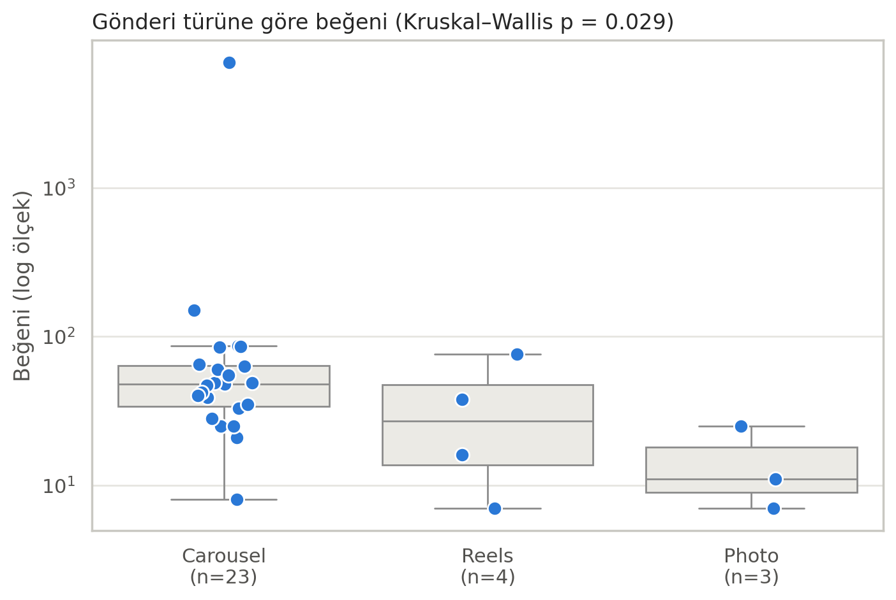
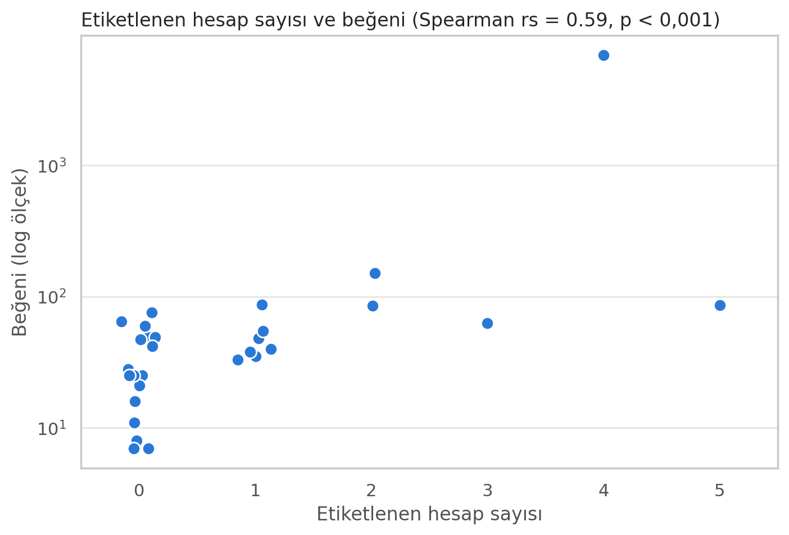
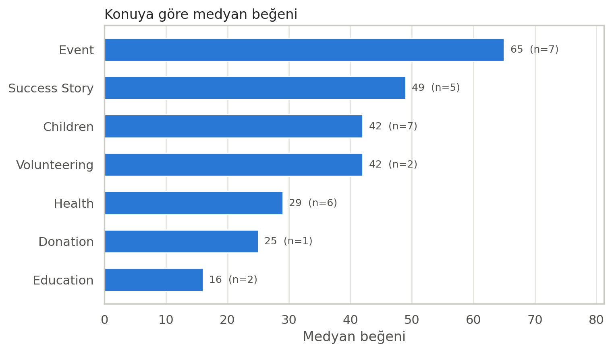

# Vakıf Instagram Hesabı: İçerik Performansı Analizi

Bir vakfın Instagram hesabında paylaşılan 30 gönderinin hangi özelliklerinin daha yüksek etkileşimle birlikte görüldüğünü inceleyen pilot veri analizi projesi. Veri toplamadan kodlamaya, Excel ve Power BI'dan Python'a kadar tüm süreç tek kişi tarafından yürütülmüştür.

*A pilot analysis of 30 Instagram posts from a foundation's account: which post features go together with higher engagement. Data collection, coding, Excel, Power BI and Python analysis.*

**Araçlar:** Excel (Power Query, pivot tablo, veri doğrulama) · Power BI · Python (pandas, seaborn, scipy)
**Yöntem:** Medyan ve IQR · Spearman korelasyonu · Mann–Whitney U · Kruskal–Wallis · Bonferroni düzeltmeli ikili karşılaştırma

---

## Temel bulgular

| # | Bulgu | Kanıt |
|---|---|---|
| 1 | Tipik bir gönderi **41 beğeni** alıyor; yorum neredeyse yok | Medyan beğeni 41 (IQR 25–62), medyan yorum 0 |
| 2 | **Etiketlenen hesap sayısı** arttıkça beğeni artıyor | Spearman rs = 0,59; p < 0,001 |
| 3 | **Carousel** gönderileri daha yüksek beğeniyle birlikte görülüyor | Kruskal–Wallis p = 0,029; Carousel–Photo Bonferroni p = 0,048 |
| 4 | **Etkinlik** ve **başarı hikâyesi** en çok ilgi gören konular | Medyan beğeni 65 ve 49 |
| 5 | **CTA** kullanımı beğeniyle ilişkili değil | Mann–Whitney p = 0,83 |







## Neden medyan?

Toplam beğeninin %84'ü tek bir gönderiden geliyor (6.980 beğeni; diğer gönderilerde en fazla 151). Bu uç değer ortalamayı 277'ye çekerken medyan 41'de kalıyor. Bu nedenle analiz boyunca medyan, çeyrekler arası aralık ve normal dağılım varsaymayan testler kullanıldı.

## Süreç

1. **Veri toplama:** Kamuya açık 30 gönderi (12.06–18.08.2026) elle kodlandı; her satır bir gönderi.
2. **Excel:** Veri temizliği, Excel Tablosu, açılır listelerle veri doğrulama, türetilmiş değişkenler (gönderi yaşı, olgunluk, etkileşim), medyan/IQR tabloları, pivot tablo ve testlerin formüllerle hesaplanması.
3. **Power BI:** Konu dilimleyicili, etkileşimli bir pano.
4. **Python:** Analizlerin tekrar üretilebilir bir notebook'ta yeniden yapılması, Excel sonuçlarının doğrulanması ve Excel'de yapılamayan ikili karşılaştırmalar.
5. **Rapor:** Bulgular, öneriler ve sınırlılıklar → [`rapor/analiz_raporu.pdf`](rapor/analiz_raporu.pdf)

## Dosyalar

| Dosya | İçerik |
|---|---|
| `analiz.ipynb` | Tüm analiz (Jupyter Notebook) |
| `veri.xlsx` | Anonimleştirilmiş veri seti |
| `figures/` | Grafikler |
| `rapor/analiz_raporu.pdf` | Kısa analiz raporu |

**Çalıştırmak için:**
```bash
pip install -r requirements.txt
```
Ardından `analiz.ipynb` dosyasını açıp **Run All** ile çalıştırın.

## Değişken sözlüğü

| Değişken | Açıklama | Değerler |
|---|---|---|
| `post_id` | Gönderi sıra numarası | 1–30 (en yeniden eskiye) |
| `date` | Yayımlanma tarihi | |
| `content_type` | Gönderi formatı | Carousel / Reels / Photo |
| `topic` | Ana içerik konusu | Education, Event, Health, Children, Success Story, Volunteering, Donation |
| `campaign` | Bir kampanyanın parçası mı | 1 / 0 |
| `language` | Açıklama metninin dili | Romanian / Turkish + English / Spanish |
| `caption_length` | Açıklama metninin uzunluğu | Short / Medium / Long |
| `hashtag_count` | Hashtag sayısı | 0+ |
| `tagged_accounts` | Etiketlenen hesap sayısı | 0+ |
| `CTA` | Harekete geçirici çağrı var mı | 1 / 0 |
| `donation_request` | Bağış talebi var mı | 1 / 0 |
| `volunteer_request` | Gönüllülük çağrısı var mı | 1 / 0 |
| `likes`, `comments` | Beğeni ve yorum sayısı | 18.08.2026 itibarıyla |
| `views` | Görüntülenme (yalnızca Reels) | boş = veri yok |
| `post_age` | Veri toplama tarihinde gönderinin yaşı (gün) | |
| `weekday`, `weekday_no` | Yayımlandığı gün | Pazartesi = 1 |
| `engagement` | Beğeni + yorum | |
| `mature` | Gönderi en az 7 günlük mü | 1 / 0 |
| `likes_rank`, `tagged_rank` | Beğeni ve etiket sayısının sırası | Eşitlerde ortalama sıra |

## Sınırlılıklar

- Küçük örneklem (n = 30); Reels (4) ve Photo (3) grupları çok küçük.
- Gözlemsel veri: bulgular ilişki gösterir, nedensellik kanıtlamaz.
- Beğeniler tek bir tarihte toplandı; en yeni gönderiler hâlâ etkileşim topluyordu.
- Takipçi sayısı, erişim ve kaydetme gibi Instagram Insights verilerine erişim yoktu.

## Sonraki adımlar

- Veri setini genişletmek ve yeni gönderileri 7. ve 30. günde ölçmek
- Veri büyüdüğünde negatif binom regresyonu ile çok değişkenli analiz
- SQL ile veri tabanı tabanlı raporlama

---
*Vakfın adı ve gönderi bağlantıları gizlilik nedeniyle paylaşılmamıştır.*
